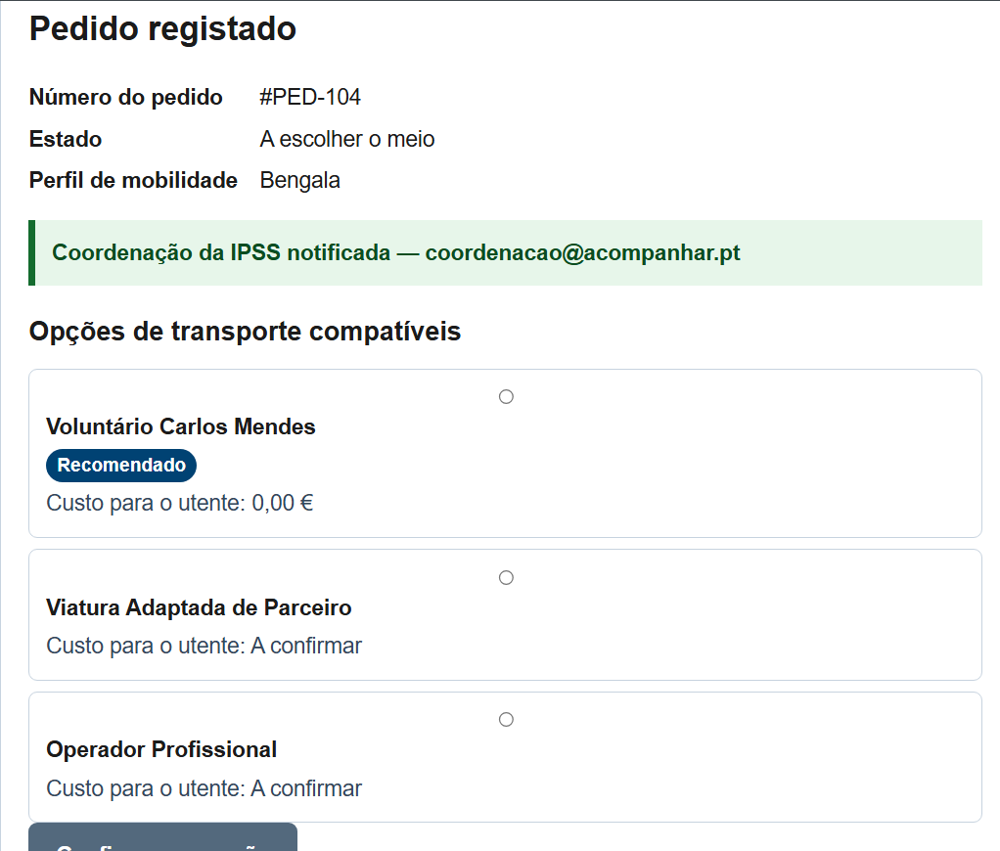
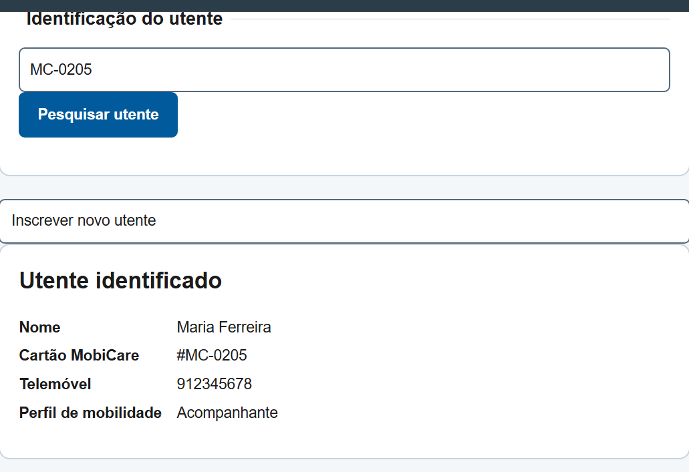
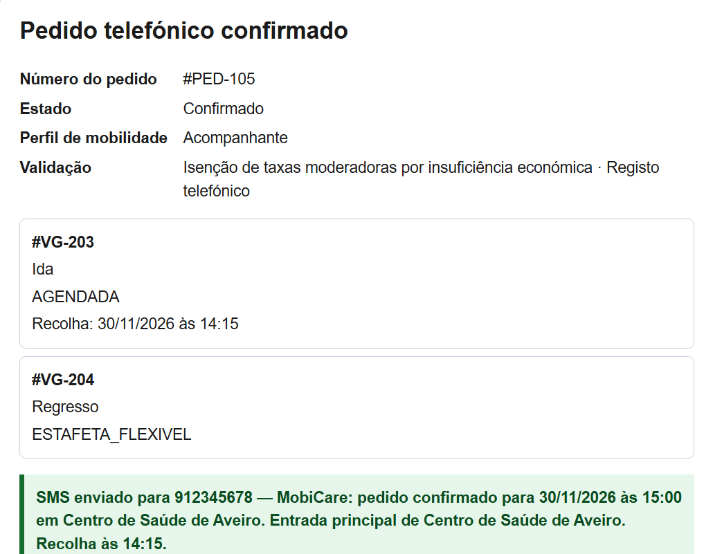
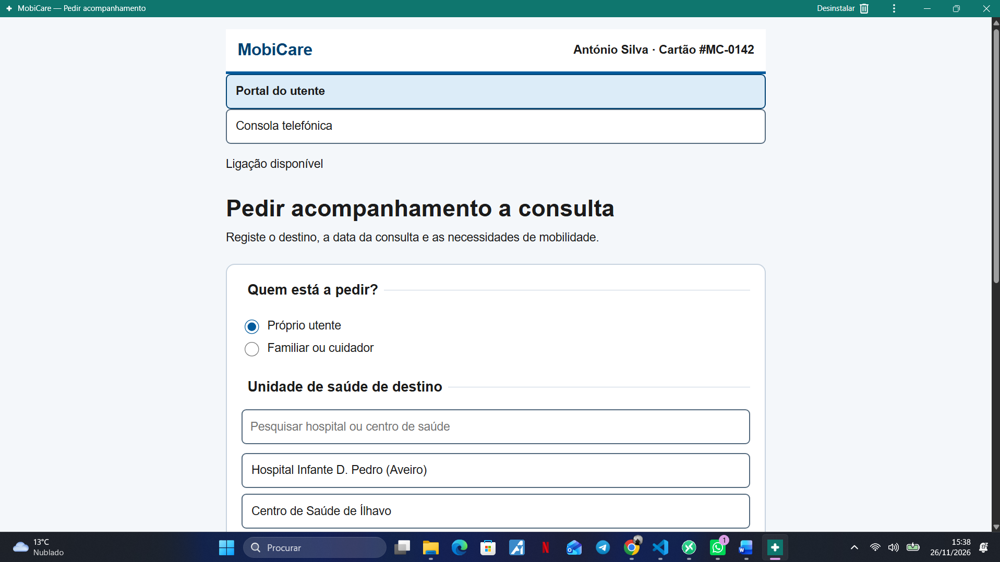

# Grupo 51 - Análise de Sistemas

## Elementos do Grupo

* Martim Almeida (NMec:126132)
* Afonso Cruz (NMec:125442)
* André Brandão (NMec:124896)
* Tiago Truta (NMec:125996)

## Recursos do Projeto

* **Jira / Ambiente de Gestão:** https://ua-projeto-as.atlassian.net/jira/software/projects/SCRUM/boards/1/backlog
* **Repositório Git:** https://github.com/martimalmeida32/ASGrupo51
* **Tag da Iteração 1:** `entrega-iter1`
* **Tag da Iteração 2:** `entrega-iter2`
* **Tag da Iteração 3:** `entrega-iter3`
* **Tag da Iteração 4:** `entrega-iter4`
* **Versão do primeiro incremento:** `v0.1`

## MobiCare

Plataforma de mobilidade assistida da Associação Acompanhar,
destinada à gestão de pedidos de transporte e acompanhamento
de pessoas seniores a consultas e exames médicos.

## Iteração 4 — Primeiro Incremento

O primeiro incremento abrange os oito slices do primeiro épico.

| Slice | Funcionalidade | Estado |
|---|---|---|
| UC-01-S1 | Registo de pedido | Concluído |
| UC-01-S2 | Recorrência e destino não listado | Concluído |
| UC-01-S3 | Triagem e sincronização offline | Concluído |
| UC-02-S1 | Filtragem em cascata e seleção de transporte | Concluído |
| UC-04-S1 | Acionamento automático do regresso | Concluído |
| UC-06-S1 | Registo telefónico e confirmação por SMS | Concluído |
| UC-06-S2 | Inscrição e exceção autorizada | Concluído |
| UC-06-S3 | Bloqueio de pedidos e urgência médica | Concluído |

## Tecnologias

- Frontend: React, TypeScript e Vite.
- Backend: Node.js e Express.
- Base de dados: SQLite.
- Armazenamento offline: IndexedDB.
- Validação de dados: Zod.
- Testes automáticos: Playwright Test.
- Desenvolvimento orientado por especificações: OpenSpec CLI 2.0.0.
- Agente de IA: OpenCode — Build, modelo Big Pickle.

## Execução da aplicação

Requisitos de execução:

- Node.js 24.
- npm.
- Google Chrome para os testes Playwright.
- OpenSpec CLI 2.0.0 para validação das especificações.

Instalar as dependências:

```bash
npm ci
```

Compilar a aplicação:

```bash
npm run build
```

Iniciar a aplicação:

```bash
npm start
```

Abrir no navegador: http://127.0.0.1:3001

## Validação e testes

Executar os testes automáticos:

```bash
npm run test:e2e
```

Validar as especificações:

```bash
openspec validate --all --strict
```

Consultar as especificações consolidadas:

```bash
openspec list --specs
```

### Resultados da Iteração 4

- 8 slices implementados e arquivados.
- 1 change complementar de suporte PWA implementada e arquivada.
- 17 testes automáticos aprovados.
- 13 requisitos consolidados em 5 especificações.
- Validação estrita do OpenSpec: 6 aprovados, 0 erros.
- Compilação concluída sem erros.
- Instalação manual da PWA validada.

## Documentação

- [E5 — Desenho](docs/design/E5-Desenho.md)
- [ADR-001 — Decisões de arquitetura](docs/adr/ADR-001-stack.md)
- [Especificações consolidadas](openspec/specs/)
- [Changes arquivadas](openspec/changes/archive/)
- [Configuração OpenSpec](openspec/config.yaml)
- [Arquitetura global do MobiCare](openspec/architecture.md)

## Demonstração do primeiro incremento — Iteração 4

A aplicação MobiCare foi validada através de testes manuais e de 17 testes automatizados com Playwright, todos aprovados.

### 1. Registo do pedido e seleção de transporte


### 2. Criação das viagens de ida e regresso


### 3. Identificação do utente na consola telefónica


### 4. Confirmação do pedido telefónico e SMS simulado


### 5. Aplicação MobiCare instalada como PWA
