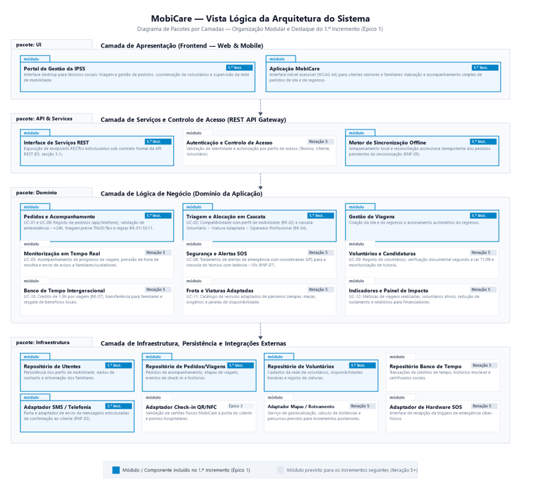
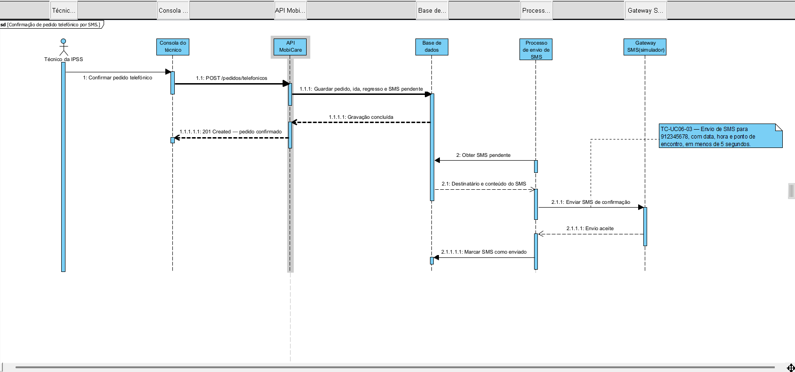
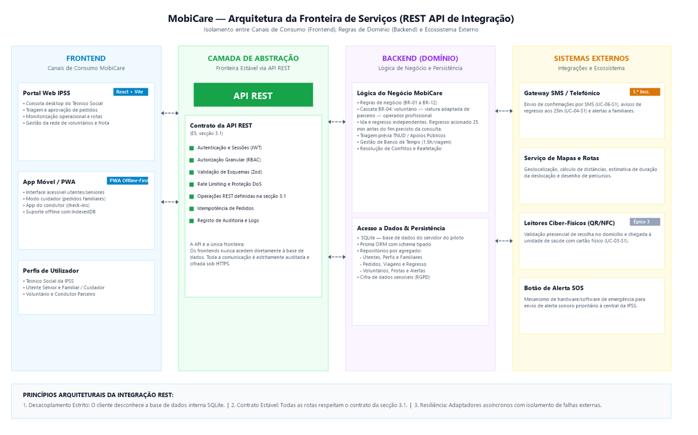

# E5 — Desenho

**Projeto:** MobiCare — Plataforma de Mobilidade Assistida

**Grupo:** André Brandão [124896], Afonso Cruz [125442], Martim Almeida [126132], Tiago Truta [125996]

**Data/versão:** 2026/11/25, v1.0

**Sumário:** O MobiCare é uma plataforma de mobilidade assistida que permite à Associação Acompanhar gerir pedidos de transporte e acompanhamento de pessoas seniores a consultas e exames. Este documento apresenta a arquitetura proposta, a integração com o serviço de SMS e a interface de serviços. Para o primeiro incremento, relaciona os oito slices do primeiro épico com as operações da API e os módulos envolvidos.

## Controlo de versões

| Data | Autor(es) | Descrição de alteração |
|---|---|---|
| 25/11/2026 | Grupo 51 | v1.0 — Desenho da arquitetura do MobiCare e especificação da API do primeiro incremento. |

## 1 Introdução

### 1.1 Sumário executivo

Este relatório apresenta o desenho técnico do MobiCare, desenvolvido no âmbito da unidade curricular de Análise de Sistemas. A plataforma disponibiliza dois canais de atendimento. O utente, familiar ou cuidador pode registar um pedido através da aplicação web. Quando o pedido é feito por telefone, um técnico da Associação Acompanhar utiliza a consola da IPSS para o registar em nome do utente.

As duas interfaces comunicam com uma API REST que concentra as regras de antecedência, triagem e seleção do transporte. Depois de escolhido o meio de transporte, o sistema cria duas viagens independentes, uma de ida e outra de regresso. Esta separação permite acionar o regresso 25 minutos antes do fim previsto da consulta, preservando o registo da ida.

O primeiro incremento abrange o registo de pedidos pontuais e recorrentes, a submissão sem ligação à Internet, a seleção de transportes compatíveis, o acionamento do regresso e o atendimento telefónico. A secção 3 identifica as operações e os módulos necessários a cada slice.

### 1.2 Utilização de recursos de IA

Na preparação da secção 2.5, utilizámos o OpenCode com o agente Build e o modelo Big Pickle para apoiar a redação do ADR-001, relativo às tecnologias e à ferramenta de testes propostas para o primeiro incremento. Na revisão do E5, utilizámos o Codex para comparar o desenho com a SRS e verificar a correspondência entre os oito slices do primeiro épico, os módulos e as operações da API. Confirmámos com o comando openspec --version que a versão do OpenSpec CLI instalada é a 2.0.0.

Na revisão, cruzámos os identificadores das changes com a tabela de rastreabilidade da SRS. Este cruzamento permitiu identificar os oito slices do primeiro épico e corrigir o enquadramento do UC-03-S1, relativo ao check-in de início de viagem, que pertence ao terceiro épico.

Para a validação dos testes, a SRS define os dados de entrada e o resultado esperado de cada cenário. Por exemplo, no TC-UC01-04, um pedido inicial em 27 de novembro de 2026 com quatro repetições semanais deve originar cinco pedidos à mesma hora, com o último em 25 de dezembro. A revisão documental abrangeu este critério. A confirmação do resultado depende da execução do respetivo teste automático.

## 2 Arquitetura do sistema

### 2.1 Objetivos gerais

A arquitetura do MobiCare foi planeada para responder às restrições sociais e técnicas específicas do contexto de apoio domiciliário e saúde em Portugal. Os pontos estruturantes que determinam as escolhas arquiteturais são:

- Acessibilidade e Inclusão Digital (Multicanal): Garantir autonomia plena a séniores de idade avançada através de interfaces com tipografia ampliada, contraste superior a 4,5:1 (WCAG AA) e fluxos lineares simples, assegurando paridade funcional de 100% via atendimento telefónico assistido por técnicos sociais e notificações por SMS (UC-06).

- Resiliência Operacional e Modo Offline-First: Em deslocações rodoviárias e no interior de edifícios hospitalares ocorrem quebras frequentes de conectividade wifi. A aplicação móvel persiste check-ins e eventos de viagem localmente no dispositivo (IndexedDB) e processa a sincronização assíncrona logo que a ligação é retomada sem qualquer perda de dados (RNF-05).

- Segurança e privacidade: A plataforma trata dados de identificação e informação sobre as necessidades de mobilidade do utente. A API deve verificar as permissões em cada operação e disponibilizar a cada interveniente apenas os dados necessários à sua função. O desenho prevê o registo do consentimento, a proteção dos dados em trânsito e em repouso e a limitação da informação partilhada com os condutores, de acordo com BR-11 e RNF-06.

- Operação Robusta e Gestão de Alertas SOS: Manter disponibilidade de 99% em infraestrutura cloud europeia redundante durante o horário de funcionamento das consultas (07h30–17h30) e suporte a alertas de emergência (UC-08) com latência máxima de 10 segundos, dispondo de contingência de envio via SMS estruturado na falta de dados móveis (RNF-07).

- Testabilidade com Playwright (Requisito Transversal): Componentes web dotados de seletores estáveis (atributos data-testid) e suporte nativo a fixtures para reposição da base de dados antes de cada execução de teste de ponta a ponta.

### 2.2 Requisitos com impacto na arquitetura

A Tabela 1 sintetiza os requisitos não funcionais e atributos de qualidade da especificação E4b-SRS que possuem impacto determinante nas decisões de desenho arquitetural do MobiCare.

*Tabela 1 — Resumo dos requisitos não funcionais com impacto na arquitetura.*

| Requisitos | Descrição e Impacto na Arquitetura |
|---|---|
| RNF-01 (Usabilidade) | A app do utente tem letra grande, contraste mínimo de 4,5:1 (WCAG AA) e poucos passos por ecrã. Condiciona o design system do frontend e os testes de acessibilidade. |
| RNF-02 (Acessibilidade) | 100% dos passos de marcação de pedido estão disponíveis por telefone através do técnico (UC-06). Exige integração com gateway de telefonia/SMS e paridade na API de pedidos. |
| RNF-03 (Desempenho) | Apresentação de opções em cascata (UC-02) e acionamento de regresso (UC-04) em 3 segundos ou menos em 95% dos pedidos. Exige consultas indexadas e cache em memória. |
| RNF-04 (Disponibilidade) | Disponibilidade mínima de 99% em ambiente cloud no horário de funcionamento (dias úteis, 07h30–17h30). Determina infraestrutura cloud redundante na UE. |
| RNF-05 (Fiabilidade) | Arquitetura offline-first: armazenamento local encriptado de eventos no dispositivo móvel e sincronização automática idempotente ao detetar ligação. |
| RNF-06 (Segurança/ RGPD) | Cumprimento estrito do RGPD: cifra de dados sensíveis em trânsito (TLS 1.3) e repouso (AES-256), controlo de acessos por perfil (RBAC) e minimização de dados (BR-11). |
| RNF-07 (Segurança SOS) | O alerta SOS chega à coordenação em menos de 10 segundos com ligação; sem dados móveis, comuta automaticamente para envio por SMS com coordenadas de satélite. |
| RNF-08 (Compatibilidade) | Portal web para técnicos em browsers modernos e aplicação móvel responsiva (PWA instalável) compatível com Android e iOS recentes. |
| RNF-09 (Escalabilidade) | Suporte a 450 utentes e 5.400 viagens por ano no piloto (≈ 22 viagens/dia útil), dimensionado com margem de crescimento de 3 vezes (1.350 utentes e 16.200 viagens/ano). |
| RNF-10 (Idioma/ Localização) | A interface e notificações estão 100% em português de Portugal (pt-PT). Exige catálogo de internacionalização (i18n) no frontend e templates de SMS/alerta rigorosamente localizados. |
| RT-1 (Testabilidade) | Aplicação web desenhada para testes automáticos de ponta a ponta com Playwright: elementos identificáveis por seletores estáveis (data-testid) e fixtures de reposição de dados. |

### 2.3 Vista geral da arquitetura

A arquitetura do MobiCare organiza-se em quatro camadas: apresentação, interface de serviços, lógica de negócio e persistência. Na camada de apresentação, o utente ou familiar utiliza a aplicação web para pedir acompanhamento e escolher o transporte. O técnico da Associação Acompanhar utiliza a consola da IPSS para registar pedidos telefónicos, pesquisar ou inscrever utentes e justificar exceções autorizadas. As duas interfaces comunicam com a mesma API REST, o que permite aplicar as mesmas regras de negócio aos dois canais.



*Figura 1— Vista lógica da arquitetura do MobiCare. Os módulos a azul integram o primeiro incremento e os módulos a cinzento estão previstos para incrementos posteriores.*

O módulo de pedidos e triagem valida a antecedência da consulta, regista as necessidades de mobilidade e sinaliza as situações que exigem avaliação pelo técnico, como um destino fora do catálogo. A partir desses dados, o módulo de transportes filtra os meios compatíveis e ordena-os segundo a regra BR-04. No cenário TC-UC02-01, a ordem esperada é voluntário, viatura adaptada de parceiro e operador profissional.

Quando o utente ou o técnico confirma o meio de transporte, o sistema cria duas viagens associadas ao mesmo pedido, uma de ida e outra de regresso. Cada viagem tem um identificador e um estado próprios.

Um processo periódico identifica a viagem de regresso e aciona-a 25 minutos antes do fim previsto da consulta, desencadeando as notificações aos intervenientes.

Na camada de persistência, a proposta do ADR-001 prevê SQLite no servidor e IndexedDB no navegador. Se a ligação falhar durante a submissão, a aplicação guarda o pedido no dispositivo com o estado «Pendente de sincronização». Quando a ligação regressa, a aplicação envia o pedido com o mesmo identificador de submissão. Assim, uma nova tentativa de envio preserva um único registo no servidor.

O primeiro incremento abrange a aplicação do utente, a consola do técnico, a API e os módulos de pedidos, triagem, seleção de transporte, regresso, sincronização e notificações. A vista geral inclui também funcionalidades previstas para incrementos posteriores, como o check-in de início de viagem, os alertas SOS e o banco de tempo.

### 2.4 Integração de sistemas e dispositivos

No primeiro incremento, o MobiCare integra-se com um serviço externo de SMS para confirmar os pedidos recebidos por telefone. A comunicação é feita através de um adaptador de SMS. Durante os testes, um simulador substitui o serviço externo e regista o destinatário, o conteúdo da mensagem e o instante do envio.



*Figura 2— Diagrama de sequência da confirmação de um pedido telefónico e envio de SMS (TC-UC06-03).*

Quando o técnico conclui o atendimento na consola, a API valida os dados e guarda o pedido confirmado, as viagens de ida e de regresso e a notificação pendente. Um processo de envio lê essa notificação e entrega a mensagem ao adaptador de SMS. O resultado do envio fica registado. Se o serviço estiver indisponível, a notificação permanece pendente para nova tentativa, sem duplicar o pedido ou as viagens.

No cenário TC-UC06-03, o teste deve verificar que o simulador recebeu uma mensagem destinada ao número 912345678, com a data, a hora e o ponto de encontro, e que o envio ocorreu em menos de cinco segundos. Esta verificação permite avaliar tanto o conteúdo da confirmação como o tempo previsto na SRS.

O cartão físico MobiCare constitui outra integração prevista no projeto. No primeiro incremento, o UC-06-S2 abrange a inscrição do utente e a atribuição do cartão. A leitura por QR ou NFC para registar o início da viagem pertence ao UC-03-S1, enquadrado no terceiro épico.

### 2.5 Decisões de arquitetura (ADR)

As decisões técnicas estruturantes encontram-se formalizadas sob o modelo Architecture Decision Record (ADR), mantendo correspondência direta com os ficheiros na pasta docs/adr/ do repositório.

*Tabela 2 — Decisões de arquitetura.*

| ADR | Decisão | Alternativas consideradas | Consequências |
|---|---|---|---|
| ADR-001 (Stack e Testes) | Desenvolver a aplicação do utente e a consola do técnico em React com TypeScript. Os dois canais utilizam a mesma API REST em Node.js com Express. O servidor guarda os dados em SQLite e a aplicação utiliza IndexedDB para conservar pedidos sem rede. Os testes automáticos do incremento são realizados com Playwright Test. | Foi considerada uma interface em HTML, CSS e JavaScript sem framework. React foi escolhido para reutilizar componentes dos formulários de pedido e manter a apresentação dos estados consistente nos dois canais. | Os dois canais podem partilhar componentes e tipos de dados. TypeScript permite detetar incompatibilidades durante o desenvolvimento. A equipa passa a manter uma etapa de compilação do frontend e continua a validar na API os dados recebidos. |

O ADR-001 encontra-se registado em docs/adr/ADR-001-stack.md. O servidor utiliza SQLite para guardar os pedidos do piloto. Durante uma falha de rede, a aplicação conserva o pedido em IndexedDB no navegador. No cenário TC-UC01-05, após o restabelecimento da ligação, o pedido deve ser sincronizado e registado uma única vez no servidor.

### 2.6 Alinhamento com processo (OpenSpec)

O E5 reúne as decisões comuns ao sistema, incluindo a organização modular, a stack, as integrações e o contrato proposto da API. Cada design.md concretiza essas decisões para um slice. Por exemplo, no UC-01-S2, a especificação indica as cinco datas que devem resultar da recorrência semanal. O desenho explica como guardar os cinco pedidos numa única transação para evitar uma série incompleta.

O openspec/config.yaml indica ao agente onde consultar o E5 e o ADR-001. As regras de design identificam os módulos e as operações afetadas. As regras de tasks associam cada cenário a uma tarefa de teste e exigem a verificação dos dados e resultados esperados antes do arquivo da change.

O excerto seguinte apresenta o contexto de arquitetura e as regras de desenho e de tarefas definidos no ficheiro openspec/config.yaml do projeto.

```yaml
context: |
  Arquitetura: docs/design/E5-Desenho.md. A aplicação do utente e a consola do técnico partilham uma API e as mesmas regras de negócio. Os módulos tratam dos pedidos e da triagem, da seleção de transporte, do regresso, da persistência, da sincronização e do envio de notificações.
  ADR-001: docs/adr/ADR-001-stack.md. A proposta de stack inclui uma PWA em React com TypeScript, uma API em Node.js com Express, SQLite no servidor, IndexedDB no navegador e Playwright Test para os testes do incremento.
  O contrato da API consta da secção 3.1 do E5. A secção 3.2 associa cada slice às operações e aos módulos envolvidos. O envio de SMS utiliza um adaptador que pode ser substituído por um simulador durante os testes.
rules:
  design:
    - "Identificar os módulos da secção 2.3 do E5 e as operações da API afetadas pelo slice."
    - "Referir os ADR aplicáveis. Um desvio à arquitetura exige um novo ADR."
    - "Descrever, quando aplicável, o que fica gravado após uma falha de ligação e como se evitam duplicados ao repetir a operação."
  tasks:
    - "Incluir uma tarefa de implementação por comportamento e uma tarefa de teste automático por scenario."
    - "Começar o nome de cada teste pelo ID exato do caso de teste da SRS."
    - "Comparar os dados usados e o resultado observado com o respetivo caso de teste da SRS."
    - "Arquivar a change apenas depois da revisão das alterações, com todas as tarefas concluídas e os testes do slice a passar."
```

## 3 Interface de serviços

A aplicação do utente e a consola do técnico da IPSS comunicam com os serviços do MobiCare através de uma API REST. A Figura 3 mostra como os dois canais acedem à lógica de negócio através dessa interface.



*Figura 3: Fronteira da API REST e isolamento entre canais de consumo, lógica do domínio e sistemas externos.*

A arquitetura prevê a utilização de tokens JWT para autenticação dos utilizadores e controlo de acesso por função (RBAC). Estes mecanismos serão integrados em incrementos posteriores. No primeiro incremento, os dados recebidos pela API são validados através de Zod antes de serem encaminhados para os módulos responsáveis pela aplicação das regras de negócio.

### 3.1 API de serviços

A Tabela 3 apresenta o contrato proposto da API REST para os slices do primeiro incremento do MobiCare.

*Tabela 3 — Contrato da API de serviços de acesso ao backend.*

| Coleção | Ponto de acesso | Funcionalidade |
|---|---|---|
| Pedidos | `POST /pedidos` | Regista um pedido pontual ou recorrente. A repetição da mesma submissão devolve o resultado original. |
| Pedidos | `GET /pedidos/{id}/opcoes` | Devolve os meios compatíveis com o perfil de mobilidade, ordenados segundo a BR-04. |
| Pedidos | `POST /pedidos/{id}/selecao` | Confirma o meio escolhido e cria duas viagens independentes, uma de ida e outra de regresso. |
| Utentes | `GET /utentes` | Permite ao técnico pesquisar um utente por número de cartão ou telefone. |
| Utentes | `POST /utentes` | Regista um novo utente e devolve o respetivo identificador e a referência do cartão MobiCare. |
| Pedidos | `POST /pedidos/telefonicos` | Valida o pedido introduzido pelo técnico, incluindo uma eventual justificação de exceção. Após a confirmação, prepara a notificação por SMS. |
| Pedidos | `GET /pedidos/{id}` | Consultar os dados, o estado e o perfil de mobilidade de um pedido registado. |
| Viagens | `POST /viagens/{id}/concluir` | Registar a conclusão da viagem de ida do utente. |

### 3.2 Mapeamento dos slices para a API e os módulos

Para assegurar a rastreabilidade integral entre a SRS e a implementação, a Tabela 4 mapeia cada slice nuclear do 1.º incremento (Épico 1) para os respetivos endpoints da API REST e os módulos da vista lógica afetados.

*Tabela 4 — Mapeamento slice → endpoint (se aplicável) → módulo.*

| Slice | Operação da API ou evento interno | Módulos da vista lógica afetados |
|---|---|---|
| UC-01-S1 — Registo do pedido | `POST /pedidos` | Aplicação do utente, pedidos, catálogo de destinos e perfil de mobilidade. |
| UC-01-S2 — Recorrência e destino não listado | `POST /pedidos` | Pedidos, recorrência, triagem e persistência. |
| UC-01-S3 — Triagem e submissão sem rede | `POST /pedidos` e recuperação da ligação | Aplicação do utente, fila local, sincronização e triagem. |
| UC-02-S1 — Seleção do transporte | `GET /pedidos/{id}/opcoes` e `POST /pedidos/{id}/selecao` | Seleção do transporte, viagens e persistência. |
| UC-04-S1 — Acionamento do regresso | Evento interno a 25 minutos do fim previsto | Processo de regresso, viagens e notificações. |
| UC-06-S1 — Registo telefónico | `GET /utentes` e `POST /pedidos/telefonicos` | Consola do técnico, pedidos, transportes e SMS. |
| UC-06-S2 — Inscrição e exceção autorizada | `POST /utentes` e `POST /pedidos/telefonicos` | Inscrição, cartão, pedidos e registo da justificação. |
| UC-06-S3 — Bloqueio do pedido telefónico | `POST /pedidos/telefonicos` | Consola do técnico, validação da antecedência e triagem de urgência. |
