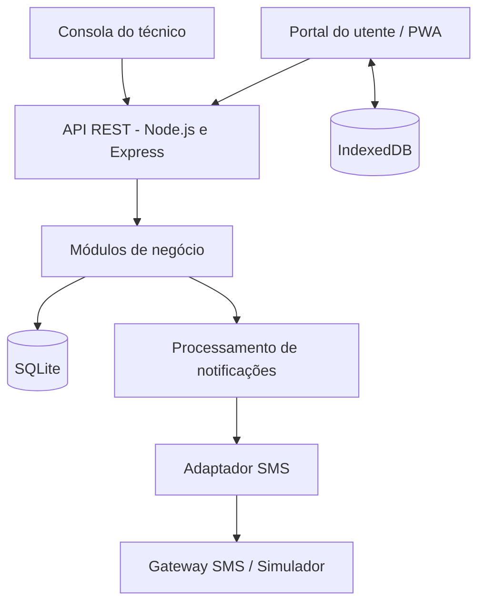

# Arquitetura do MobiCare

## 1. Visão geral

O MobiCare adota uma arquitetura modular, separando a apresentação,
a lógica de negócio, a persistência de dados e a integração com
serviços externos.

A aplicação do utente e a consola do técnico da IPSS partilham
uma API REST e as mesmas regras de negócio.

## 2. Arquitetura de componentes

## 3. Tecnologias

| Componente | Tecnologia |
|---|---|
| Frontend | React e TypeScript |
| Build | Vite |
| Backend | Node.js e Express |
| Comunicação | API REST e JSON |
| Validação de dados | Zod |
| Base de dados do servidor | SQLite |
| Persistência offline | IndexedDB |
| Testes automatizados | Playwright |
| Desenvolvimento orientado por especificações | OpenSpec |

## 4. Módulos e responsabilidades

- **Pedidos e triagem:** registo de pedidos, validação da antecedência,
  recorrência e identificação de possíveis apoios públicos.
- **Seleção de transporte:** filtragem por mobilidade e ordenação
  em cascata dos meios disponíveis.
- **Gestão de viagens:** criação independente das viagens de ida
  e de regresso.
- **Gestão de regressos:** cálculo do fim previsto da consulta
  e acionamento automático do regresso.
- **Atendimento telefónico:** identificação e inscrição de utentes,
  registo assistido de pedidos e gestão de exceções.
- **Persistência:** armazenamento dos dados em SQLite.
- **Sincronização:** armazenamento local em IndexedDB e submissão
  automática após recuperação da conectividade.
- **Notificações:** gestão de avisos e confirmações através
  de um adaptador de SMS.

## 5. Contrato da API REST

| Método | Operação | Responsabilidade |
|---|---|---|
| POST | /pedidos | Registar pedido |
| GET | /pedidos/{id} | Consultar pedido |
| GET | /pedidos/{id}/opcoes | Obter transportes compatíveis |
| POST | /pedidos/{id}/selecao | Confirmar transporte |
| GET | /utentes | Pesquisar utentes |
| POST | /utentes | Inscrever utente |
| POST | /pedidos/telefonicos | Registar pedido telefónico |

O contrato detalhado da API encontra-se na secção 3.1 do E5.

## 6. Persistência e resiliência

- SQLite constitui a base de dados central do primeiro incremento.
- IndexedDB permite armazenar pedidos pendentes no dispositivo.
- Os pedidos offline são sincronizados automaticamente quando
  a conectividade é restabelecida.
- A idempotência impede a criação de pedidos duplicados.
- As operações de criação de pedidos recorrentes são transacionais.

## 7. Integração com serviços externos

A integração com o gateway SMS é realizada através de um adaptador,
permitindo a utilização de um simulador no primeiro incremento.

O processamento periódico de regressos é realizado no servidor.

## 8. Segurança e qualidade

- Validação dos dados recebidos pela API através de Zod.
- Minimização dos dados pessoais recolhidos.
- Registo de auditoria das exceções autorizadas.
- Interface orientada para a acessibilidade dos utilizadores seniores.
- Testes automatizados associados aos casos de teste da SRS.

A autenticação JWT e o controlo de acesso baseado em funções (RBAC)
estão previstos para incrementos posteriores.

## 9. Âmbito do primeiro incremento

| Slice | Funcionalidade |
|---|---|
| UC-01-S1 | Registo de pedidos |
| UC-01-S2 | Recorrência e destinos personalizados |
| UC-01-S3 | Triagem e funcionamento offline |
| UC-02-S1 | Filtragem e seleção de transporte |
| UC-04-S1 | Acionamento automático do regresso |
| UC-06-S1 | Atendimento telefónico |
| UC-06-S2 | Inscrição e exceções autorizadas |
| UC-06-S3 | Bloqueios e triagem de urgência |

O incremento foi validado através de 12 testes automatizados
com Playwright.

## 10. Decisões arquiteturais e referências

- ADR-001: `docs/adr/ADR-001-stack.md`
- Relatório E5: `docs/design/E5-Desenho.md`
- SRS: `assets/E4-SRS/E4a_SRS_MobiCare.pdf`

As alterações à arquitetura devem ser documentadas através de ADR
e consideradas nos artefactos design.md das changes OpenSpec.